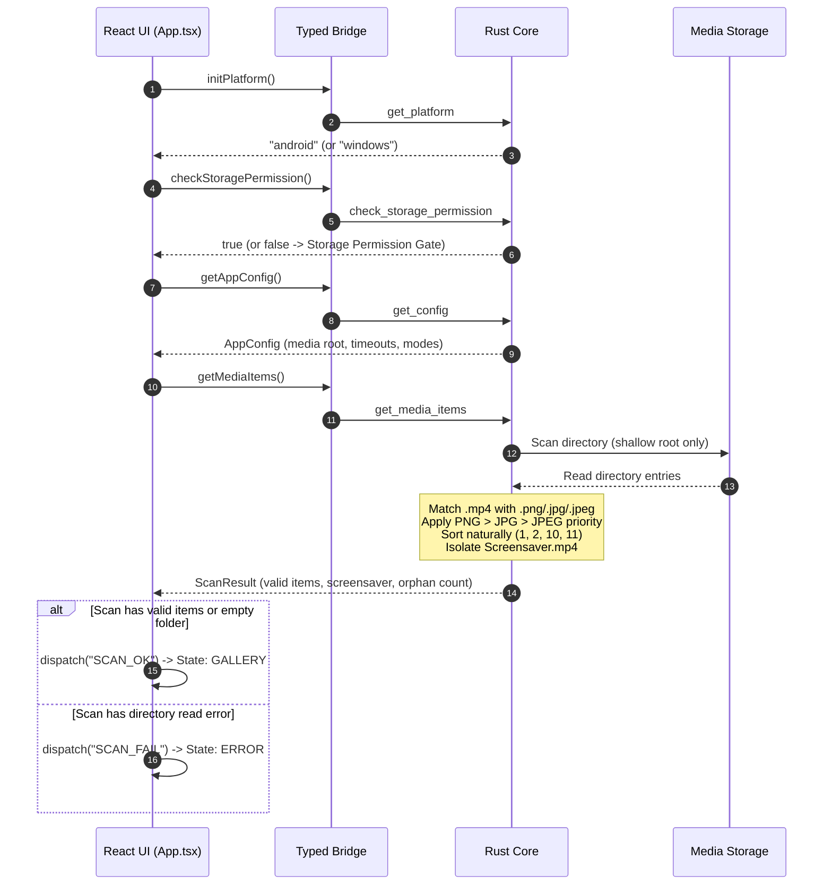
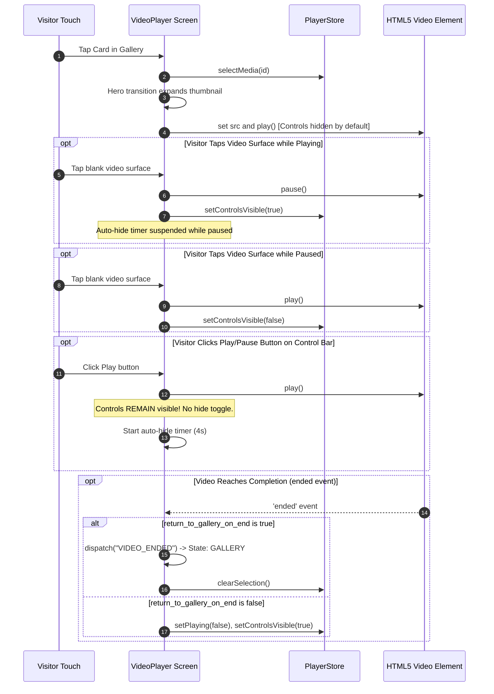
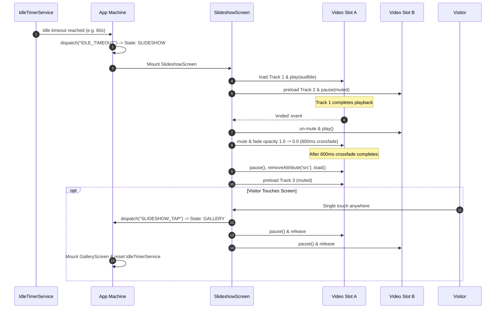

# Architecture Specification: Kiosk Video Player

## 1. System Architecture

The application adopts a hybrid Tauri v2 architecture designed for high responsiveness, minimal attack surface, and stable memory usage on Android TV and Windows.

```mermaid
flowchart TD
    subgraph Frontend["Renderer Layer (React 19 + TypeScript + Vite)"]
        Stage["Stage Scaler (1920x1080 -> Viewport Scale)"]
        UI["Screens: Gallery | VideoPlayer | Slideshow | AdminPanel"]
        Stores["Zustand Stores: ApplicationStore | MediaStore | PlayerStore | SettingsStore"]
        Services["Core Services: IdleTimerService | AudioService (Web Audio) | DiagnosticsService"]
        Bridge["Typed Tauri Bridge (src/renderer/src/services/bridge.ts)"]
    end

    subgraph IPC["Tauri IPC Boundary"]
        Commands["Tauri Commands: get_config, get_media_items, set_media_root, write_diagnostics, exit_kiosk_app"]
        Events["Tauri Events: media-changed, open-admin-panel"]
    end

    subgraph Backend["Rust Core Layer (src-tauri)"]
        ConfigMgr["ConfigManager (.env fallback + AppData JSON override)"]
        Scanner["MediaScanner (Regex pairing, PNG>JPG priority, Natural sort)"]
        Watcher["Debounced Directory Watcher (2.0s debounce, dirty reload)"]
        CmdHandlers["Validated Command Handlers"]
    end

    subgraph OS["Target Operating System (Android TV / Windows)"]
        Storage["Filesystem: /sdcard/Kiosk/Media (Android) or C:/Media (Windows)"]
        WebView["Platform WebView (Android System WebView / WebView2)"]
    end

    Stage --> UI
    UI --> Stores
    UI --> Services
    Stores --> Bridge
    Bridge -->|JSON-RPC via invoke()| Commands
    Events -->|listen()| Bridge
    Commands --> CmdHandlers
    CmdHandlers --> ConfigMgr
    CmdHandlers --> Scanner
    CmdHandlers --> Watcher
    Scanner --> Storage
    Watcher --> Storage
    WebView --> Frontend
```

---

## 2. Sequence Diagrams

### 2.1 Application Startup & Media Discovery



### 2.2 Individual Video Playback & Tap Contract



### 2.3 Idle Timeout & Dual-Video Slideshow Crossfade


